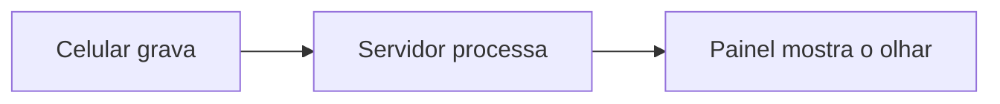

# Eye tracking por vídeo no smartphone

Protótipo de pesquisa que coleta vídeo no Android para estimar o olhar na tela, com processamento planejado em um PC Windows. **Status: em desenvolvimento; fluxo completo ainda não disponível.**

O diagrama representa o objetivo, não serviços já disponíveis.

## Estado atual

Verificado por inspeção do código e documentação em 02/11/2026: o app contém gravação frontal sem áudio, apresentação local de vídeo e alvos e persistência local de eventos; a identificação de experimento é simulada. Build, testes unitários e lint são executados na CI. **Não foi verificada aqui uma coleta em aparelho**: câmera, vídeo gerado, sincronização e precisão precisam de validação. Não existem ainda backend, upload, processamento MediaPipe nem painel neste repositório. Veja [Android](apps/android/README.md) e [contexto](docs/contexto-projeto.md).

## Pré-requisitos

- Windows com Android Studio, SDK Android (plataforma 37 e build-tools 36.0.0) e JDK 25 para o Gradle; o projeto inclui wrapper Gradle 9.6.0.
- Aparelho Android com câmera frontal, Android 7.0/API 24 ou superior e depuração USB para instalar pelo Gradle. Nenhum modelo ou versão em aparelho foi validado nesta revisão.
- Para o servidor planejado: Docker Desktop com WSL2. Não há Compose ou servidor neste estágio; veja [ambiente Windows](docs/ambiente-windows.md).

## Quickstart

1. Clone o repositório: `git clone https://github.com/marcelopera/eye_tracker.git` e `cd eye_tracker`.
2. Abra `apps/android` no Android Studio e instale o SDK indicado. Configure o SDK localmente pelo Android Studio; não compartilhe `local.properties`.
3. O servidor ainda não existe, portanto não há serviço para configurar ou subir.
4. Conecte o aparelho com depuração USB, autorize-o e execute `cd apps/android` seguido de `gradlew.bat :app:installDebug` no Prompt de Comando (no PowerShell use `.\gradlew.bat :app:installDebug`).
5. Abra o app, informe um identificador de experimento para a simulação, selecione um vídeo local e inicie. O app solicita acesso à câmera. Confira no aparelho se a sessão termina e se os arquivos privados foram gerados. Esta é uma verificação local, não uma coleta validada para pesquisa.

Para compilar e executar testes e lint, veja [Android](apps/android/README.md). Não use vídeos ou dados de participantes reais sem as aprovações e o protocolo aplicáveis.

## Organização e planejamento

- [apps/android](apps/android/README.md): coleta local; [apps/web](apps/web/README.md): painel planejado.
- [services](services/README.md): backend planejado; [ml](ml/README.md): processamento planejado; [infra](infra/README.md): infraestrutura planejada.
- [Documentação técnica](docs/): [decisão de arquitetura](docs/adr/0001-recorte-atual.md), [convenções e pesquisa](docs/convencoes-pesquisa.md), [ambiente Windows](docs/ambiente-windows.md) e [inventário do app legado](docs/inventario-app.md).
- [Milestones e issues](https://github.com/marcelopera/eye_tracker/milestones) registram as seis etapas e seus critérios de aceite.

## Contribuir, licença e citação

Abra uma issue para discutir mudanças, implemente uma etapa por vez e envie um pull request com as verificações realizadas. Não inclua dados pessoais, vídeos, modelos ou segredos no Git. O código é distribuído sob [MIT](LICENSE); dados, vídeos, modelos e dependências de terceiros têm [condições próprias](docs/licencas-terceiros.md). Para citar o projeto, consulte [CITATION.cff](CITATION.cff).

Com [Task](https://taskfile.dev/) e Python 3 instalados, `task test`, `task lint` e `task doctor` executam as verificações disponíveis. `task setup` chama o diagnóstico; a instalação do SDK continua manual. `task up`, `down`, `logs` e `fmt` informam que ainda não há implementação correspondente e terminam com erro. O diagnóstico não altera firewall e não verifica portas ainda não definidas.
