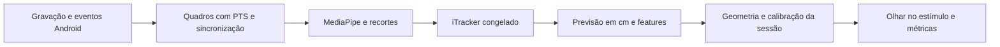

# Plano de implementação: iTracker pré-treinado

Data das verificações: 02/11/2026. Estado: plano proposto; a pipeline de produção ainda não foi implementada.

## Objetivo e recorte

Implementar o iTracker com pesos oficiais congelados, executado após a coleta no servidor do laboratório. O Android continua responsável pela gravação e pelos registros de apresentação. A primeira entrega será um processamento por arquivos, executável por linha de comando e em Docker, com estimativas, métricas e uma visualização para inspeção.

O núcleo usará o modelo Caffe publicado pelos autores. MediaPipe será usado para localizar rosto e olhos no servidor, sujeito à validação dos recortes. A calibração por sessão poderá ajustar regressores SVR sobre as features da rede; isso não envolve treinar novamente a rede neural.

A adaptação para Android altera a origem das imagens e das detecções. Portanto, o resultado será uma implementação do método com pesos publicados, cuja precisão precisa ser medida no novo cenário. Reproduzir integralmente os experimentos do artigo é outro escopo: envolve dataset, variantes, aumentação na inferência e protocolos correspondentes.

Backend de experimentos, upload e painel web não são dependências da primeira entrega. A transferência inicial do pacote será explícita e local; o mecanismo e os formatos serão definidos na etapa 1.

## O que foi verificado

### Código e documentação locais

O código Android relevante foi inspecionado nas revisões locais `80eaa800ad9cf5d3b8154526ed5c72c59ccd2701` e `2363a9238f51e5a004fcaf1724263a6cc9dd9240`. A comparação não mostrou diferenças no código de produção Android entre elas. Durante a verificação, o checkout ativo passou da branch `issue/1-ajustar-repositorio` para `main`; este plano preserva esse checkout.

O [contexto do projeto](contexto-projeto.md) foi lido. O [ADR-0001 consultado](https://github.com/marcelopera/eye_tracker/blob/80eaa800ad9cf5d3b8154526ed5c72c59ccd2701/docs/adr/0001-recorte-atual.md) pertence à revisão da documentação inicialmente disponível e ainda não existe na main inspecionada. Sua decisão sobre MediaPipe precisa ser compatibilizada com a adoção do iTracker antes da implementação.

| Componente | Evidência por inspeção | Consequência para o plano |
| --- | --- | --- |
| [Gravação](../apps/android/app/src/main/java/br/com/marcelopera/eye_tracking/session/CameraRecordingEngine.kt) | Usa CameraX, câmera frontal e gravação sem habilitar áudio. Não registra uma correspondência por quadro entre captura e relógios da apresentação. | Reaproveitar o gravador e validar os arquivos em aparelho; não usar o callback de início como sincronização comprovada. |
| [Protocolo](../apps/android/app/src/main/java/br/com/marcelopera/eye_tracking/session/SessionController.kt) | Apresenta marcadores, cinco posições únicas de calibração em dez exposições, descanso, estímulo e cinco posições distintas de validação. | Preservar a separação das fases. As posições e durações atuais são provisórias. |
| [Apresentação](../apps/android/app/src/main/java/br/com/marcelopera/eye_tracking/MainActivity.kt) | Usa VideoView; registra callbacks de Choreographer e início/fim do estímulo. | Ainda faltam os PTS efetivamente apresentados e a geometria completa do vídeo. Callback de frame da interface não comprova o instante de apresentação do quadro do vídeo. |
| [Persistência](../apps/android/app/src/main/java/br/com/marcelopera/eye_tracking/data/SessionRepository.kt) | Grava o vídeo e um JSON com eventos; dados dos alvos são armazenados em uma string separada por vírgulas. Há rótulos de relógio diferentes nos eventos. | Definir esquema versionado e a transformação entre relógios, PTS, tela e estímulo. |
| Processamento | Não foi encontrada uma pipeline executável nas pastas reservadas para processamento e serviços. | Implementar um núcleo pequeno, com integração inicial por arquivos. |

Esses achados são de inspeção. Não houve coleta, teste de câmera ou reprodução em aparelho nesta tarefa.

### Referência oficial e arquivos do modelo

Foram consultados o [artigo v1](https://arxiv.org/pdf/1606.05814v1), a documentação e o código do [GazeCapture](https://github.com/CSAILVision/GazeCapture/tree/e4af90da3c4c9068fbce433fa648d1f9bc7a394b). O anexo local não estava acessível; a consulta usou a mesma identificação e versão no arXiv.

A revisão oficial foi fixada em `e4af90da3c4c9068fbce433fa648d1f9bc7a394b`. A [API da árvore oficial](https://api.github.com/repos/CSAILVision/GazeCapture/git/trees/e4af90da3c4c9068fbce433fa648d1f9bc7a394b?recursive=1) contém dois snapshots Caffe, as imagens médias, os modelos e um checkpoint PyTorch. O site separado do dataset não respondeu às consultas; isso não impediu os downloads pelo GitHub.

O [README PyTorch](https://github.com/CSAILVision/GazeCapture/blob/e4af90da3c4c9068fbce433fa648d1f9bc7a394b/pytorch/README.md) informa que essa reimplementação é simplificada e remete à versão Caffe para os resultados originais. O plano, portanto, parte do snapshot Caffe treinado com aumentação 25x. Isso não habilita automaticamente aumentação na inferência nem equivale à variante ajustada por dispositivo/orientação do artigo.

Os cinco arquivos abaixo foram efetivamente baixados em uma pasta temporária. Seus tamanhos e hashes de objetos Git coincidiram com os metadados obtidos separadamente da API oficial. Os SHA-256 abaixo são fingerprints calculados nesta verificação, não checksums publicados pelos autores.

| Arquivo oficial | Bytes | SHA-256 calculado |
| --- | ---: | --- |
| [Snapshot Caffe 25x](https://raw.githubusercontent.com/CSAILVision/GazeCapture/e4af90da3c4c9068fbce433fa648d1f9bc7a394b/models/snapshots/itracker25x_iter_92000.caffemodel) | 32616358 | `d748042ebd402a4b6418cdff44a6e64f9bca1256fd3761f7ddc68fd5519ef98a` |
| [Definição de inferência](https://raw.githubusercontent.com/CSAILVision/GazeCapture/e4af90da3c4c9068fbce433fa648d1f9bc7a394b/models/itracker_deploy.prototxt) | 8839 | `93a984a55829f07813859a068d9bf30ec8b3161d7121f715a9a9124b34cfdb76` |
| [Média do rosto](https://raw.githubusercontent.com/CSAILVision/GazeCapture/e4af90da3c4c9068fbce433fa648d1f9bc7a394b/models/mean_images/mean_face_224.mat) | 506824 | `43dccf2f655259b23d3b2cd20907f5d7479e175215caba6bb310d3a4c3fc4756` |
| [Média do olho esquerdo](https://raw.githubusercontent.com/CSAILVision/GazeCapture/e4af90da3c4c9068fbce433fa648d1f9bc7a394b/models/mean_images/mean_left_224.mat) | 509839 | `b502c0c7392cea761688625f2be8b0359fc9df74599ef744ce37b7dc68dcb470` |
| [Média do olho direito](https://raw.githubusercontent.com/CSAILVision/GazeCapture/e4af90da3c4c9068fbce433fa648d1f9bc7a394b/models/mean_images/mean_right_224.mat) | 508008 | `15167a33bc553cf624869be2717129362ea2a3445ba26676927a6f63205e2ef0` |

As três médias foram abertas com SciPy: arrays float32, dimensões 224 × 224 × 3 e valores finitos. A equivalência entre sua ordem de canais e as médias binaryproto usadas no treinamento Caffe ainda deve ser testada na implementação do pré-processamento.

A [licença dos autores](https://github.com/CSAILVision/GazeCapture/blob/e4af90da3c4c9068fbce433fa648d1f9bc7a394b/LICENSE.md) restringe o material a pesquisa, exige citação e impõe restrições de redistribuição. Os arquivos de terceiros serão obtidos no ambiente local, separados do código próprio, e ficarão fora do Git e de imagens de container publicadas.

### Execução e dependências

As dependências foram instaladas somente em pastas temporárias, sem criar configuração ou ambiente Python no projeto. A combinação completa abaixo foi importada e exercitada no mesmo processo, em Linux x86-64 sobre WSL2:

| Dependência | Versão testada |
| --- | --- |
| Python | 3.12.3 |
| NumPy | 2.5.4 |
| SciPy | 1.18.1 |
| opencv-contrib-python | 4.14.0.94; cv2 informa 4.14.0 |
| MediaPipe | 1.2.0 |
| PyAV | 19.0.2 |
| scikit-learn | 1.9.1 |

| Verificação executada | Resultado e limite |
| --- | --- |
| OpenCV 5.0.0.93 com o snapshot Caffe | Falhou: a API readNetFromCaffe não existe nessa instalação. A versão do OpenCV precisa ser fixada em 4.x. |
| OpenCV 4.14, modelo Caffe e quatro entradas sintéticas | Passou em CPU: saída fc3 com forma 1 × 2 e features relufc2 com forma 1 × 128, ambas finitas. Primeiro foi testada a distribuição headless; depois o teste passou com a distribuição contrib exigida pelo MediaPipe. |
| Face Landmarker em CPU e modo vídeo | Inicialização passou; uma imagem preta retornou zero rostos. Não foi testada a detecção de um rosto real nem a adequação dos recortes. |
| PyAV com vídeo sintético de intervalos irregulares | Preservou os tempos 0, 0,040 e 0,115 segundos na decodificação usando PTS e time base. Não foi testado um MP4 de aparelho. |
| SVR com dados sintéticos | Ajuste e predição passaram, com resultados finitos. Os parâmetros padrão usados no teste não constituem uma configuração científica adotada. |
| Docker | Cliente e daemon 29.7.2 responderam fora do sandbox. Nenhuma imagem da pipeline foi construída ou executada. |

O modelo auxiliar testado foi o [Face Landmarker float16, versão 1](https://storage.googleapis.com/mediapipe-models/face_landmarker/face_landmarker/float16/1/face_landmarker.task), com 3758596 bytes e SHA-256 calculado `64184e229b263107bc2b804c6625db1341ff2bb731874b0bcc2fe6544e0bc9ff`. A referência funcional é a [documentação oficial do Face Landmarker](https://developers.google.com/edge/mediapipe/solutions/vision/face_landmarker/python).

O teste conjunto exigiu execução fora do sandbox: dentro dele, o MediaPipe abortou na consulta do número de CPUs. Isso não impediu sua execução no ambiente ampliado. O funcionamento em uma imagem Docker limpa permanece um critério de aceite futuro.

A instalação comum do MediaPipe declara dependência de opencv-contrib-python. O ambiente final deve conter uma única distribuição que fornece cv2, fixada na versão 4 testada; instalar simultaneamente headless, contrib e a distribuição comum deve ser evitado.

Não foram executados build, testes ou lint Android: o Java encontrado no PATH é 21; o JDK 25 exigido pelo projeto precisa ser localizado/configurado. Não foram identificados ADB, variáveis de SDK nem configuração local do SDK neste ambiente. Isso não determina o que está instalado na máquina Windows do pesquisador.

## Pendências e quando elas bloqueiam

| Pendência | Responsável ou fonte | Etapa afetada |
| --- | --- | --- |
| Registrar iTracker congelado e o papel auxiliar do MediaPipe na decisão de arquitetura | Implementação da decisão discutida com o pesquisador | 1 |
| Aprovar os campos de entrada/saída, unidades, convenções e compatibilidade com coletas existentes | Proposta técnica e revisão do pesquisador | 1 |
| Modelo exato do aparelho, dimensões físicas da tela e posição da câmera em relação à área ativa | Pesquisador; especificação dimensional confiável ou medição documentada | 4 e 5 |
| Sessão piloto com alvos conhecidos e arquivos completos | Coleta em aparelho | 4 a 7 |
| Origem, transformação e erro dos relógios e sinais de sincronização | Implementação Android e medição no aparelho | 4 |
| Regras dos recortes, normalização e sua compatibilidade com o modelo Caffe | Implementação com testes e inspeção das imagens | 3 |
| Protocolo de calibração/validação e parâmetros do SVR | Pesquisador e documentação metodológica | 6 |
| Critérios numéricos de erro, perda e sincronização aceitáveis para a demonstração | Pesquisador, antes da avaliação final | 4 e 7 |
| Ambiente Android e imagem Docker reproduzível | Preparação do ambiente | 2, 4 e 7 |

O aparelho e a sessão piloto ainda não foram informados nesta conversa. Esses dados não impedem implementar e testar o núcleo com entradas controladas. Impedem concluir a integração e declarar precisão no cenário de uso.

O dataset GazeCapture completo não é necessário para executar o modelo pré-treinado. Para uma comparação numérica com os resultados publicados, serão necessários dados e protocolo correspondentes; uma coleta Android não substitui esse benchmark.

## Etapas de implementação

Executar uma etapa por vez. A etapa seguinte começa quando o respectivo critério de conclusão estiver atendido; dúvidas sobre parâmetros científicos ou de coleta devem ser resolvidas com o pesquisador.

### 1. Fixar a decisão, o escopo e o contrato

- Antes de implementar, criar uma branch a partir da main atualizada, preservando as alterações locais e vinculando a tarefa à issue correspondente quando definida.
- Registrar a decisão sobre iTracker pré-treinado em ADR, preservando o histórico da decisão anterior; reconciliar a documentação da main com a revisão da documentação consultada.
- Fixar checkpoint, revisão oficial, execução no servidor, rede congelada e papel do MediaPipe e do SVR.
- Propor e revisar um contrato versionado para vídeo, eventos, calibração/validação, perfil do aparelho e integridade dos arquivos. Definir explicitamente os dados ausentes nas coletas antigas.
- Definir as saídas: tempo da câmera, tempo do estímulo quando disponível, coordenadas e seus referenciais, validade e motivo de falha, versão dos modelos e configuração usada. Os nomes de campos e arquivos serão definidos nesse contrato.
- Registrar quais variantes estão incluídas: baseline sem calibração e baseline com SVR por sessão. Aumentação na inferência e variantes ajustadas por dispositivo precisam de escopo e parâmetros próprios.

**Pronto quando:** ADR e contrato estiverem revisados, houver exemplos sintéticos válidos e inválidos e nenhuma convenção necessária ao núcleo depender de suposição silenciosa. As informações do aparelho poderão permanecer como campos obrigatórios para as etapas que as utilizam.

### 2. Criar o ambiente reproduzível e o núcleo Caffe

- Criar o pacote Python e a interface de linha de comando na área de processamento existente, com dependências fixadas a partir da combinação testada.
- Preparar a instalação em container Linux, inicialmente em CPU; verificar bibliotecas nativas e as dependências transitivas.
- Implementar aquisição de arquivos oficiais por revisão e um manifesto de proveniência e integridade. Diferenciar hashes de objetos Git de fingerprints SHA-256 calculados localmente.
- Manter pesos, médias, dados e resultados fora do Git. Conferir cobertura para extensões Caffe e arquivos de checkpoints compostos, além dos diretórios locais já ignorados.
- Carregar a rede, fornecer as quatro entradas e expor predição e features. Falhar de forma clara se o modelo estiver ausente, inválido ou incompatível.

**Pronto quando:** o mesmo teste de inferência controlada passar em ambiente limpo e em Docker, com saída finita de duas coordenadas e vetor de 128 features, sem GPU e sem dataset completo. Isso conclui a primeira entrega executável, ainda sem coleta real.

### 3. Implementar decodificação, detecção e pré-processamento

- Decodificar os quadros preservando PTS e time base, conforme a [API do PyAV](https://pyav.org/docs/stable/api/frame.html). Preservar timestamps originais mesmo se a API do detector exigir outra unidade.
- Aplicar rotação e política de espelhamento documentadas, usando o olho esquerdo do participante como referência.
- Usar o Face Landmarker no servidor para obter os recortes; definir e registrar a regra geométrica e as margens, sem tratá-las como equivalentes às detecções Apple por presunção.
- Produzir rosto e olhos 224 × 224 e face grid 25 × 25. Conferir arredondamento, limites e ordem de achatamento contra as funções de referência oficiais.
- Conferir ordem RGB/BGR, escala dos valores, redimensionamento e subtração das médias com a configuração Caffe. Não reutilizar automaticamente a normalização da implementação PyTorch.
- Registrar amostras sem detecção e recortes inválidos com seus timestamps, sem preencher coordenadas artificiais. Tornar as inspeções visuais locais opcionais.

**Pronto quando:** testes com casos de borda confirmarem grid, recortes, canais, rotação e médias; quadros reais autorizados forem inspecionados; a saída mantiver a correspondência entre quadros válidos e inválidos e seus tempos.

### 4. Completar a coleta e medir a sincronização

- Reaproveitar a estrutura Android e o gravador existentes. Validar gravação contínua, ausência de áudio, orientação, finalização e interrupções em aparelho.
- Registrar o perfil efetivo da captura e a geometria de tela, área dos alvos e retângulo real de apresentação do estímulo.
- Implementar e validar uma correspondência entre o relógio da captura, PTS gravados, eventos dos alvos e apresentação do estímulo. Os relógios atualmente rotulados de formas diferentes precisam de uma transformação explícita.
- Instrumentar a reprodução para obter os tempos dos quadros apresentados, adaptando o player se necessário. Não deduzir esses tempos apenas do início/fim de VideoView.
- Testar se os marcadores visuais são identificáveis na gravação frontal e medir offset e deriva. Se forem insuficientes, definir outro vínculo temporal comprovável antes de concluir a etapa.
- Exportar o pacote conforme o contrato. Sessões incompletas e coletas antigas sem sincronização suficiente devem ter tratamento explícito.

**Pronto quando:** uma sessão piloto fornecer arquivos íntegros e relações temporais verificáveis, com erro e deriva medidos dentro do critério combinado. Executar `./gradlew :app:assembleDebug :app:testDebugUnitTest :app:lintDebug` em apps/android com o ambiente adequado e registrar separadamente os resultados em aparelho. Índice dividido por FPS não será aceito como sincronização.

### 5. Converter a previsão para tela e estímulo

- Criar um perfil do aparelho com dimensões físicas verificadas, pixels da área ativa, orientação e posição da câmera. Não substituir essas informações por um DPI presumido.
- Transformar centímetros relativos à câmera em pixels físicos da tela e, depois, em coordenadas do vídeo original, incluindo barras, insets, recortes e escala.
- Preservar a previsão bruta e identificar pontos fora da tela ou fora do estímulo. Qualquer limitação de coordenadas para exibição deve ficar separada da avaliação.
- Relacionar cada previsão ao tempo do estímulo usando a sincronização validada, preservando as amostras sem correspondência.

**Pronto quando:** casos geométricos conhecidos confirmarem centro, bordas, rotação e barras; uma sessão real puder ser inspecionada sobre o estímulo; metadados físicos ausentes impedirem a conversão de forma explícita.

### 6. Implementar a calibração por sessão

- Extrair as features da camada de fusão anterior à regressão final e ajustar SVRs para x e y com a rede congelada, seguindo a abordagem da seção 5.3 do artigo.
- Conferir o mapeamento de nomes: no deploy publicado, a fusão final é fc2/relufc2 e a saída é fc3. A camada fc1 do deploy pertence ao ramo dos olhos; selecionar apenas pelo nome usado no artigo produziria as features erradas.
- Combinar com o pesquisador posições, repetições, intervalos de fixação aproveitados, regras de rejeição e quantidade mínima de dados. O protocolo local atual não é o de 13 posições usado no estudo de calibração do artigo.
- Definir kernel, C, epsilon, escala das features e estratégia de seleção dos parâmetros. Os materiais consultados não fornecem uma receita completa que permita assumir equivalência científica desses parâmetros.
- Usar somente dados de calibração no ajuste e na escolha de parâmetros. Reservar a validação para medir erro; manter disponível a previsão sem calibração para comparação.

**Pronto quando:** a calibração puder ser reproduzida por sessão, os testes demonstrarem que dados de validação não entram no ajuste e o relatório separar resultados com e sem calibração, incluindo falhas por dados insuficientes.

### 7. Integrar e validar a demonstração completa

- Executar pelo mesmo comando o pacote completo: validação dos arquivos, sincronização, pré-processamento, inferência, conversão e calibração quando disponível.
- Produzir as saídas definidas no contrato e uma visualização local do olhar sobre o estímulo, preservando a proveniência de modelos, configuração e perfil do aparelho.
- Medir erro euclidiano em centímetros e pixels nos alvos reservados, variação durante fixações e percentual de amostras inválidas, com denominadores e critérios de exclusão explícitos. Só reportar erro angular se houver geometria e distância adequadas para calculá-lo.
- Medir tempo total, memória e vazão em uma sessão completa no PC de destino. O teste sintético não será usado como benchmark de desempenho ou precisão.
- Cobrir ausência de modelo, pacote inválido, vídeo corrompido, rosto ausente e sessão interrompida, além do caso completo.
- Documentar instalação, aquisição dos modelos, entrada/saída e reprodução em Docker. Preparar o PR com as verificações automatizadas e de dispositivo identificadas separadamente.

**Pronto quando:** uma coleta piloto do aparelho informado produzir resultados rastreáveis sobre o estímulo, com métricas e limites documentados, e o fluxo puder ser repetido em ambiente limpo. A conclusão demonstra a pipeline no cenário medido; não comprova os números do artigo nem generalização para outros participantes.

## Próxima ação

Começar pela etapa 1 e, após fixar decisão e contrato, entregar o núcleo da etapa 2. A disponibilidade dos arquivos e a execução básica do modelo já foram comprovadas. A integração depende principalmente da instrumentação temporal, do perfil físico do aparelho e de uma coleta piloto para validar os recortes e a precisão.
